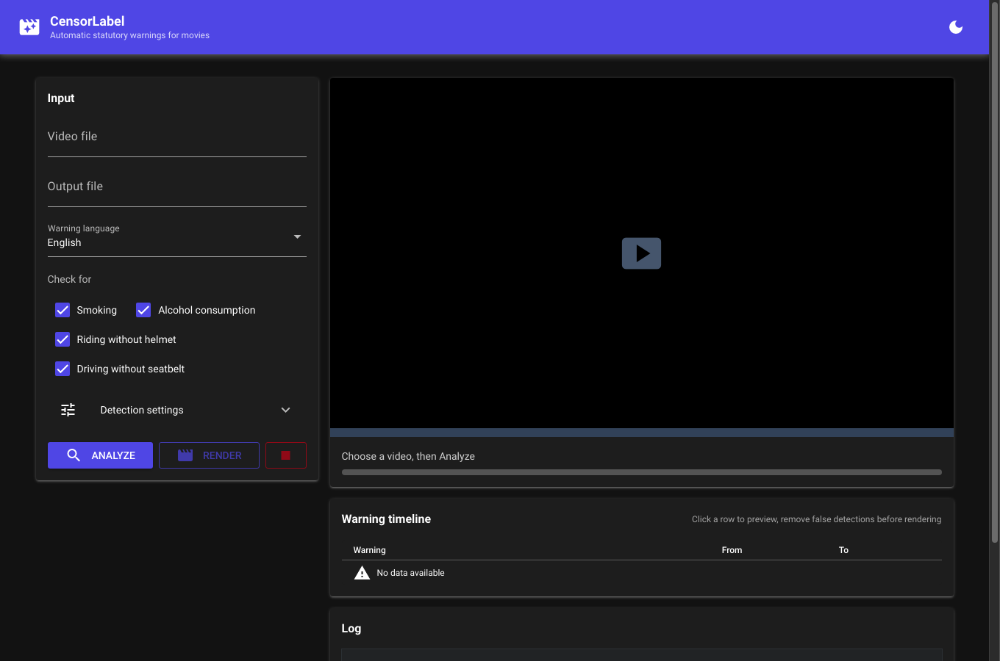
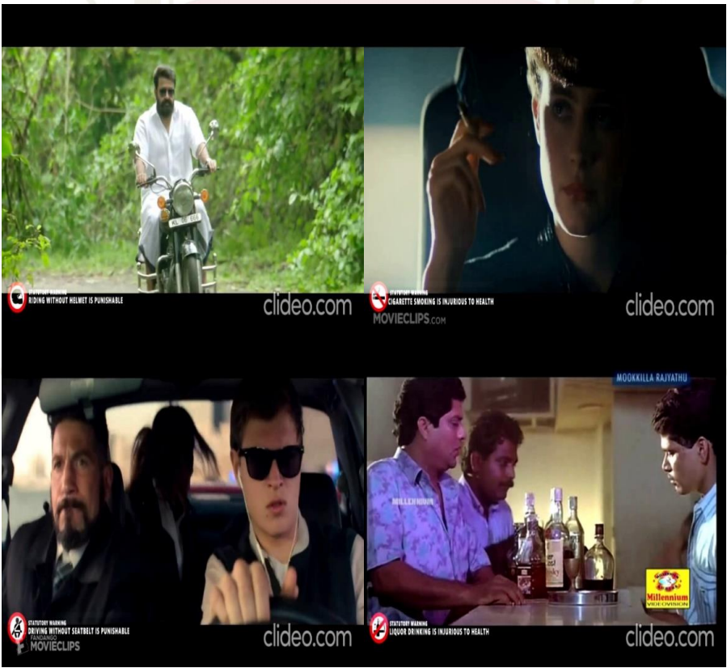

# CensorLabel

Automated detection of censorable content in movies using deep learning. CensorLabel finds scenes that
show **smoking**, **alcohol**, **riding without a helmet** or **driving without a seatbelt** and
burns the matching statutory warning into the video.



## How it works

CensorLabel uses **one detector** in a two-stage pipeline:

1. **Analyze.** ffmpeg decodes about 4 frames per second, downscaled to 640px. A single
   [YOLOE](https://docs.ultralytics.com/models/yoloe/) model finds cigarettes, alcohol bottles and
   glasses, motorcycles, helmets, steering wheels, seat belts and people in batches on the GPU
   (CUDA, Apple MPS or CPU). Simple rules turn those detections into violations, for example a
   person on a motorcycle with no helmet on their head. A debounced timeline then needs 2 hits in
   3 samples, holds each banner for a few seconds, and merges nearby segments.
2. **Review.** The app lists the warning timeline. Click a row to preview the banner on that
   scene, and remove false detections.
3. **Render.** One ffmpeg pass burns the banners into those segments, using a hardware encoder
   when available (VideoToolbox or NVENC), and copies the audio untouched.

On a MacBook (Apple silicon), a 3-minute 720p clip is analyzed in about 10 seconds (around
17× real time). Analysis plus rendering takes about 20 seconds.

### Accuracy and fine-tuning

YOLOE is *open-vocabulary*: it detects objects from text prompts with no training. Helmets,
alcohol and seatbelts work well. Cigarettes are small and score low, so they get their own
threshold (`class_confidence`) and the timeline filters out the extra noise. That is why the
review step exists.

For production accuracy, fine-tune a YOLO model on frames from real movies and pass it with
`--model path/to/best.pt`. The rules also accept direct labels (`no_helmet`, `no_seatbelt`,
`smoking`, `alcohol`), so a fine-tuned model can predict violations directly.

## Architecture

```
src/censorlabel/
├── domain.py        Pure types: WarningKind, Box, Detection, Segment
├── config.py        Settings, detector prompts, thresholds
├── rules.py         Pure per-frame rules (helmet, seatbelt, smoking, alcohol)
├── timeline.py      Pure debouncing/merging of samples into warning segments
├── detectors/       ObjectDetector protocol + Ultralytics YOLO/YOLOE implementation
├── overlay.py       Banner loading, transparency, compositing and export
├── media.py         ffmpeg sampling, probing and single-pass rendering
├── events.py        Progress / Log / SegmentFound / Preview / Finished events
├── pipeline.py      analyze() → render(): emits events, supports cancellation
├── cli.py           `censorlabel` command
└── ui/app.py        `censorlabel-gui` desktop app (NiceGUI)
```

The pipeline only talks to the detector through a small protocol and reports progress through
events, so the CLI, the GUI and the tests share the same core. The tests use a fake detector and
don't need the model.

## Requirements

* Python 3.12+ and [uv](https://docs.astral.sh/uv/)
* [Git LFS](https://git-lfs.com/) to fetch the models with the repo (`brew install git-lfs`, then `git lfs install`)
* ffmpeg is optional: a binary comes with `imageio-ffmpeg` if ffmpeg isn't installed.

Set `CENSORLABEL_HOME` to use a different directory for `models/` and `Images/statutory/`.

## Models

The models are stored in this repo with Git LFS under [`models/`](models/). If you cloned without
LFS, run `git lfs pull`. If the files are missing, the app downloads them from Ultralytics on first run.

| File | Size | Purpose | Source URL |
|---|---|---|---|
| `models/yoloe-26s-seg.pt` | 30 MB | YOLOE-26 small: the open-vocabulary detector | https://github.com/ultralytics/assets/releases/download/v8.4.0/yoloe-26s-seg.pt |
| `models/mobileclip2_b.ts` | 242 MB | MobileCLIP2 text encoder; turns the detection prompts into embeddings (only needed when the prompts change) | https://github.com/ultralytics/assets/releases/download/v8.4.0/mobileclip2_b.ts |
| `models/yoloe-26s-seg-031fd26c.prompts.pt` | 32 KB | Cached embeddings for the prompts in `config.py`, so the text encoder isn't loaded at runtime | generated |

Model docs: [YOLOE](https://docs.ultralytics.com/models/yoloe/) ·
[Ultralytics assets](https://github.com/ultralytics/assets/releases/tag/v8.4.0).
The models are AGPL-3.0, like the Ultralytics library.

## Usage

```bash
uv sync --extra native             # pywebview gives a native window; omit for browser mode
uv run censorlabel-gui             # desktop app
uv run censorlabel-gui --browser   # same UI in the browser at http://localhost:8080

uv run censorlabel movie.mp4 -o movie-labeled.mp4
uv run censorlabel movie.mp4 --analyze-only          # print the warning timeline as JSON
uv run censorlabel movie.mp4 --model yoloe-26m-seg.pt --fps 6 --device cuda
```

Warning languages are the folders in `Images/statutory/`. To add one, create a folder with
`helmet.png`, `smoke.png`, `alcohol.png`, `smokealcohol.png` and `seatbelt.png`. The images can be
PNGs with transparency, or artwork on a black background.

> **License note:** Ultralytics (YOLO/YOLOE) is AGPL-3.0. That's fine for this open-source
> project. A closed-source product needs an Ultralytics license, or another detector that
> implements the `ObjectDetector` protocol.

## Development

```bash
uv run --group dev pytest
```

## Result


## Support

Open for contributing to this project. Ping me on linkedin https://linkedin.com/in/akhilgkrishnan
